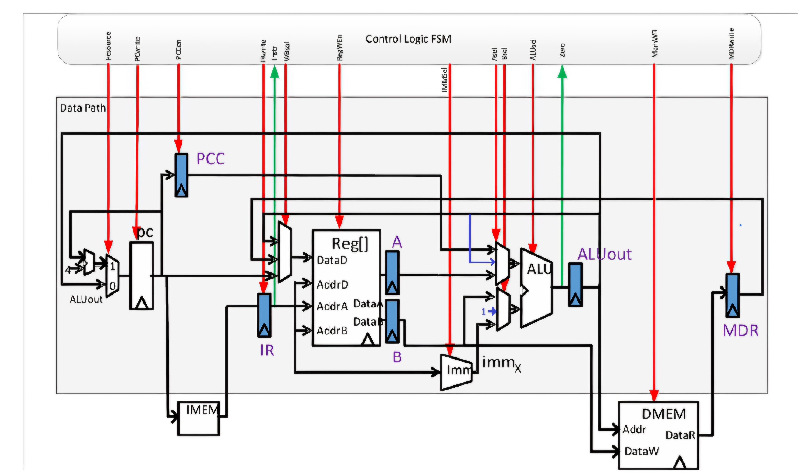
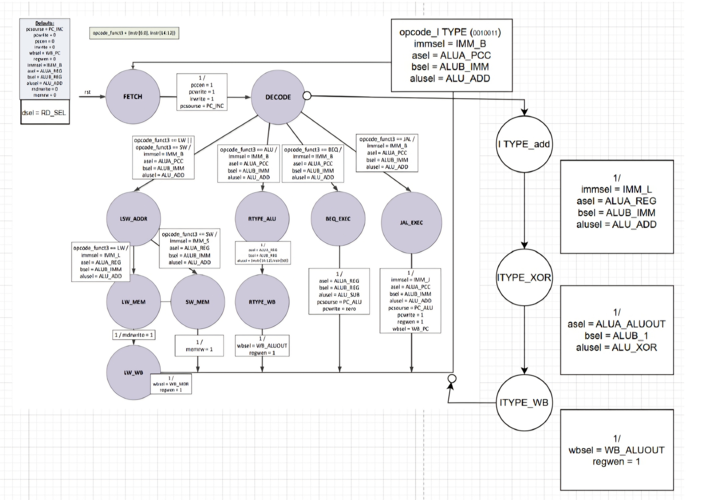
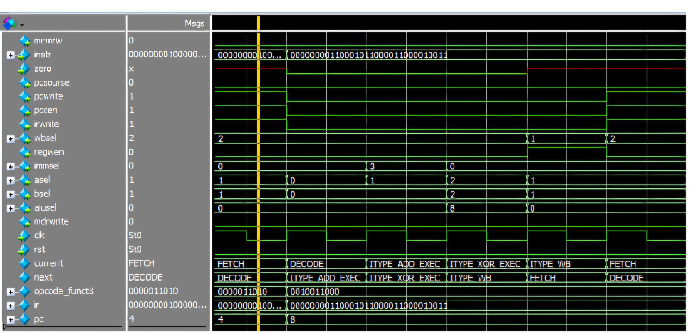

# Multicycle RISC-V Processor – Custom Instruction Extension

## Overview
This repository contains a SystemVerilog implementation of a 32-bit Multicycle RISC-V processor. The baseline processor architecture supports core RV32I instructions (`LW`, `SW`, R-type ALU operations, `BEQ`, and `JAL`) and was architected and extended to support a custom multi-cycle immediate instruction (`addi` with bitwise inversion).

The custom instruction (`Opcode: 0010011`, `Funct3: 000`) executes the following compound operation directly in hardware across consecutive clock cycles:

$$R[rd] = (R[rs1] + \text{SignExt}(imm[11:0])) \oplus \text{0xFFFFFFFF}$$

Implementing this instruction without introducing additional general-purpose registers required structural modifications to the Datapath (`rv_dp.sv`) and expanding the Mealy Control Finite State Machine (`rv_ctl.sv`).

---

## Architectural Modifications

### 1. Datapath Upgrades (`rv_dp.sv` & `params.inc`)
To compute sequential arithmetic (`ADD`) and logical (`XOR`) operations using a single ALU across back-to-back cycles, two hardware routing paths were added:
* **ALU Output Feedback Path (`ALUA_ALUOUT`):** Expanded the ALU `A` input multiplexer (`asel`) to accept the latched `aluout` register value from the previous cycle (`2'b10`), feeding the intermediate addition result directly back into the ALU.
* **Hardcoded Inversion Constant (`ALUB_1`):** Expanded the ALU `B` input multiplexer (`bsel`) with a dedicated constant input (`32'hffff_ffff`, selected via `2'b10`) to perform the bitwise XOR inversion.



### 2. Control FSM Expansion (`rv_ctl.sv`)
Three dedicated states were integrated into the Mealy Control FSM following the `DECODE` stage whenever `opcode_funct3` matches `I_TYPE` (`10'b0010011_000`):
1. **`ITYPE_ADD_EXEC` (Cycle 3):** Extracts and sign-extends the 12-bit immediate (`immsel = IMM_L`), routes `rs1` (`asel = ALUA_REG`) and the immediate (`bsel = ALUB_IMM`) into the ALU, and executes `ALU_ADD`. The intermediate sum is latched into `aluout` while `regwen` remains `0`.
2. **`ITYPE_XOR_EXEC` (Cycle 4):** Routes the latched intermediate sum (`asel = ALUA_ALUOUT`) and the all-ones constant (`bsel = ALUB_1`) into the ALU, executing `ALU_XOR`. The final result is latched into `aluout`.
3. **`ITYPE_WB` (Cycle 5):** Routes `aluout` to the register file write-back bus (`wbsel = WB_ALUOUT`) and asserts `regwen = 1'b1` to store the result in `rd` before transitioning back to `FETCH`.



---

## Repository Structure

| File | Description |
| :--- | :--- |
| `rv_top.sv` | Top-level processor module connecting the Control FSM and Datapath. |
| `rv_dp.sv` | 32-bit Multicycle Datapath (PC, Register File, Immediate Generator, ALU, muxes). |
| `rv_ctl.sv` | Mealy Control Finite State Machine managing datapath control signals and state transitions. |
| `params.inc` | Architecture parameters, instruction opcodes, ALU opcodes, and mux select constants. |
| `rv_sim.sv` | Top-level SystemVerilog testbench with instruction/data memory models and execution monitor. |
| `test.s` | RISC-V assembly verification program testing `lw`, the custom `addi`, and `sw`. |
| `imem.hex` | Compiled hexadecimal machine code loaded into instruction memory. |
| `dmem_init.hex` | Initial hexadecimal data memory image. |

---

## Verification & Simulation

The processor was verified in **ModelSim** using `rv_sim.sv` and the assembly test program `test.s`:
1. Loads initial data from memory address `8` (`0x00000BED`) into register `a1` (`lw a1, 8(x0)`).
2. Executes the custom `addi a2, a1, 12` instruction (`0x00C58613`), computing `(0xBED + 12) ^ 0xFFFFFFFF = 0xFFFFF406`.
3. Writes the result from `a2` to memory address `16` (`sw a2, 16(x0)`).
4. Triggers the testbench completion sequence by writing `0xDEAD` to address `0xFFFF`, dumping the final memory state to `dmem_out.hex`.



### Running the Simulation in ModelSim
```tcl
vlib work
vlog *.sv
vsim rv_sim
add wave -r /*
run -all
